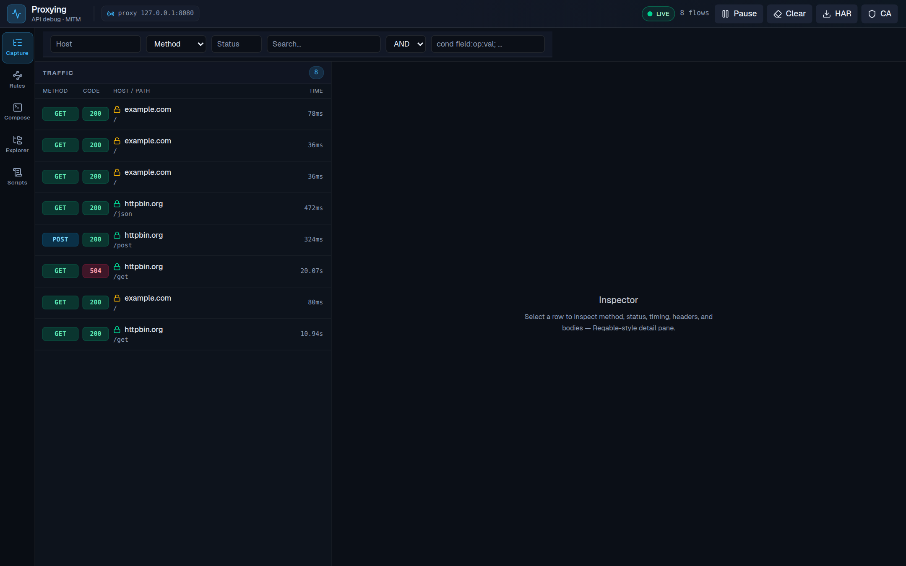
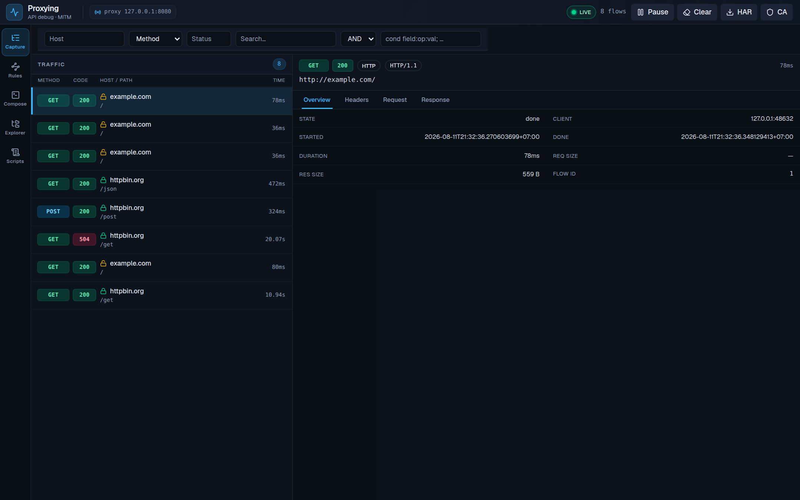
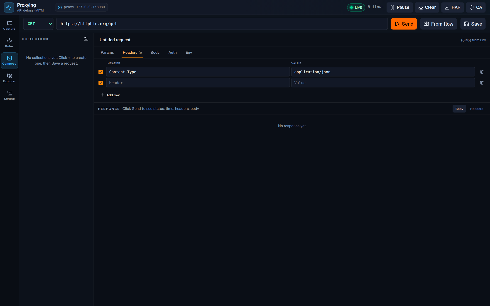

# proxying

**Local-first HTTP(S) MITM capture** — Web UI, REST Compose, rules, scripts, breakpoints, and MCP for AI agents.

No cloud. No accounts. No phone-home. Data stays on your machine (`~/.proxying` by default).

| Listen | Role |
|--------|------|
| `127.0.0.1:8080` | MITM proxy |
| `127.0.0.1:9090` | Web UI + control API + MCP HTTP |

<p align="center">
  
</p>

<p align="center">
  
  
</p>

> Full guide (install, CA trust, Android, API, troubleshooting): **[docs/USAGE.md](docs/USAGE.md)**

---

## Quick start

```bash
make release          # build Web UI + bin/proxying
./bin/proxying        # or: go run ./cmd/proxying
```

Open **http://127.0.0.1:9090** — traffic list, rules, REST panel.

```bash
./bin/proxying -version
./bin/proxying \
  -proxy-addr 127.0.0.1:8080 \
  -api-addr 127.0.0.1:9090 \
  -data-dir ~/.proxying
```

### Point traffic at the proxy

```bash
export http_proxy=http://127.0.0.1:8080
export https_proxy=http://127.0.0.1:8080
curl -v https://example.com/
```

### Trust the local CA (HTTPS MITM)

```bash
curl -o proxying-ca.pem http://127.0.0.1:9090/api/ca.pem
```

| OS | Trust store |
|----|-------------|
| **Linux** | `sudo cp proxying-ca.pem /usr/local/share/ca-certificates/proxying-ca.crt && sudo update-ca-certificates` — or NSS: `certutil -d sql:$HOME/.pki/nssdb -A -t "C,," -n proxying -i proxying-ca.pem` |
| **macOS** | `sudo security add-trusted-cert -d -r trustRoot -k /Library/Keychains/System.keychain proxying-ca.pem` |
| **Windows** | `certutil -addstore -f Root proxying-ca.pem` |

The CA private key lives under `-data-dir` with mode `0600`. **Never share it.**

---

## Features

- **MITM capture** — HTTP/HTTPS (goproxy), ring-buffer store, live SSE updates
- **Rules** — host allow/block, header/body rewrite, map-local (path-jailed)
- **JS scripts** — `onRequest` / `onResponse` via goja (sandboxed + timeout)
- **Breakpoints** — pause matched request/response, resume with optional edit
- **REST Compose** — send requests, env `{{var}}`, collections on disk, from-flow
- **Import / export** — HAR, CHLS; capture pause
- **Embedded SPA** — single binary with Web UI
- **MCP** — tools for OpenCode, Cursor, Claude Desktop

---

## Security defaults

| Default | Why |
|---------|-----|
| Bind `127.0.0.1` only | API + MITM not exposed on the LAN |
| CA key mode `0600` | Root of trust for all MITM certs |
| Scripts sandboxed + timeout | goja: no OS/network; default 100ms |
| Breakpoints max 32 + 60s timeout | Caps held connections |
| REST `http`/`https` only | `file://` rejected |
| map-local path jail | No filesystem escape |

This is a **debug tool on your machine**. Anyone who can reach the API can read captures and drive the proxy. Do **not** bind `0.0.0.0` without access control.

---

## Scripts

Place `*.js` under `~/.proxying/scripts/` (or your `-data-dir`):

```js
function onRequest(flow) {
  flow.request.headers["X-Debug"] = "1";
}

function onResponse(flow) {
  flow.response.headers["X-Out"] = "1";
}
```

Allowlisted fields only: `request.{method,url,headers,body}`, `response.{status,headers,body}`.

---

## Breakpoints

```bash
# enable + match
curl -X PUT http://127.0.0.1:9090/api/breakpoints \
  -H 'Content-Type: application/json' \
  -d '{"enabled":true,"match":{"host":"example.com"}}'

# list holds
curl http://127.0.0.1:9090/api/breakpoints

# resume (optional header edits)
curl -X POST http://127.0.0.1:9090/api/breakpoints/{id}/resume \
  -H 'Content-Type: application/json' \
  -d '{"headers":{"X-Edited":"1"}}'
```

**Limit:** a hold blocks the proxy request goroutine until resume or timeout. CONNECT tunnel frames and HTTP/2 multiplexing are not paused independently. Client ALPN is advertised as `http/1.1` for full body capture.

---

## REST API (examples)

```bash
curl -X POST http://127.0.0.1:9090/api/rest/send \
  -H 'Content-Type: application/json' \
  -d '{"method":"GET","url":"https://example.com/"}'

curl -X POST http://127.0.0.1:9090/api/rest/from-flow/{id}

curl -X PUT http://127.0.0.1:9090/api/rest/env \
  -H 'Content-Type: application/json' \
  -d '{"env":{"base":"https://api.example.com"}}'
```

---

## MCP (AI agents)

### Tools

| Tool | Description |
|------|-------------|
| `list_flows` | List MITM captures (host / method / status / query) |
| `get_flow` | Full flow by id |
| `clear_flows` | Clear buffer |
| `set_capture_paused` | Pause or resume capture |
| `rest_send` | Send an HTTP(S) request |
| `rest_from_flow` | Build/send REST from a capture |
| `list_rules` | List MITM rules |
| `add_host_block_rule` | Block a host |

### Stdio (OpenCode / Cursor / Claude Desktop)

```json
{
  "mcpServers": {
    "proxying": {
      "command": "/absolute/path/to/proxying",
      "args": ["-mcp-stdio", "-data-dir", "/home/you/.proxying"]
    }
  }
}
```

Use the **same** `-data-dir` as the running UI process so the agent sees live captures.

### Streamable HTTP

While the UI is running:

```
http://127.0.0.1:9090/mcp
```

### Legacy helpers (web UI)

- `GET /api/mcp/tools`
- `POST /api/mcp/call` with `{"name":"list_flows","arguments":{}}`

---

## Android (short)

1. Run: `./bin/proxying -proxy-addr 0.0.0.0:8080 -api-addr 127.0.0.1:9090`
2. Install `ca.pem` as a **user CA** on the device
3. Wi‑Fi proxy → `PC_LAN_IP:8080`
4. Many apps need repack + `networkSecurityConfig` that trusts user CAs; certificate pinning needs extra bypass

Details: [docs/USAGE.md](docs/USAGE.md) (Android section) and [docs/android-mitm.md](docs/android-mitm.md).

---

## Develop

```bash
make test       # Go tests
make build-go   # binary only (uses committed embedded UI)
make build      # rebuild web + go embed
make release    # versioned release build
```

Prerequisites: **Go 1.22+** (built with 1.25), **Node 20+** only when rebuilding the Web UI.

---

## Docker Compose

```bash
cd deploy/compose
docker compose up -d --build
```

See [deploy/compose/README.md](deploy/compose/README.md). Binds `127.0.0.1` only; data volume persists CA and rules.

---

## License

MIT — see [LICENSE](LICENSE).

---

## Credits

Built with help from **Grok-4.5** (xAI).
